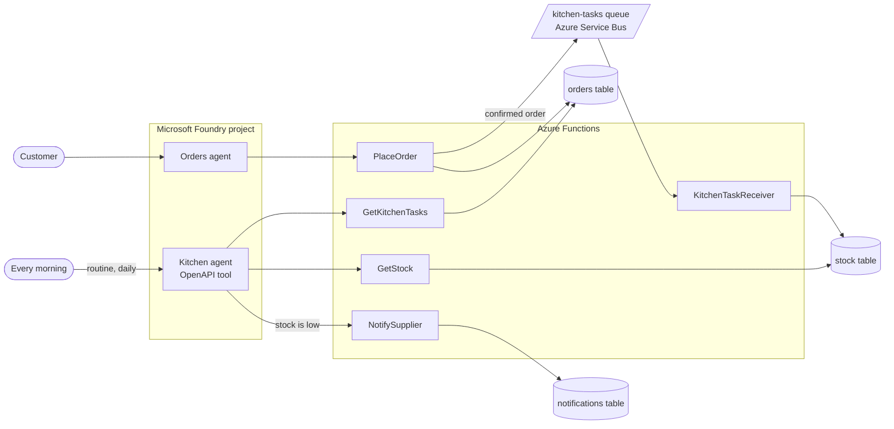

# The Kitchen agent on Azure: event-driven and scheduled AI agents

**Give your agent a reason to work even when nobody's chatting to it.** Sample files for part 4 of
the Blue Penguin Bakery series on the Infra2AI YouTube channel, where we build **Penny**, an AI
assistant for a fictional bakery, in Microsoft Foundry.

**Watch:** [the series on YouTube](https://www.youtube.com/playlist?list=PLUKvmDqPth-M) ·
**Part 1:** [video](https://www.youtube.com/watch?v=5beCrJJskUk) · [code](https://github.com/infra2ai/first-ai-agent) ·
**Part 2:** [code](https://github.com/infra2ai/rag-on-azure) ·
**Part 3:** [code](https://github.com/infra2ai/multi-agent-on-azure)

## The story so far

In [part 1](https://github.com/infra2ai/first-ai-agent) we built Penny in Microsoft Foundry. In
[part 2](https://github.com/infra2ai/rag-on-azure) she got Azure AI Search. In
[part 3](https://github.com/infra2ai/multi-agent-on-azure) she got a teammate, the **Orders
agent**, which places custom cake and catering orders in an orders table.

A confirmed order used to just sit in that table until somebody looked. Now the kitchen needs to
know the moment an order is confirmed, and it needs to check the stock every morning, whether a
new order came in or not. We give it a **Kitchen agent** that starts working two ways, neither of
them a chat message:

- **An event.** The moment `PlaceOrder` confirms an order, it also sends a message to a **Service
  Bus** queue. A function reacts to it immediately, and takes the ingredients it used off the
  stock table.
- **A schedule.** A Microsoft Foundry **routine** runs the Kitchen agent itself once a day. It
  reads today's confirmed orders and the stock, and asks the supplier for anything running low.

Showing a real email arrive needs a mailbox this demo tenant doesn't have (and Azure Communication
Services Email is being retired), so "asking the supplier" here means writing a row to a
`notifications` table you can see in the Storage browser. The README's
[production notes](#before-you-use-this-for-real) say where a real email or purchase order would
go instead.

## The series

| Part | Video | What Penny learns | Code |
|---|---|---|---|
| 1 | [Build your first AI agent on Azure](https://www.youtube.com/watch?v=5beCrJJskUk) | Answers from files, analyses data with code, calls the bakery's order API, guardrails, tracing, and her own website | [infra2ai/first-ai-agent](https://github.com/infra2ai/first-ai-agent) |
| 2 | Azure AI Search for AI agents | Searches all of the bakery's documents, always up to date | [infra2ai/rag-on-azure](https://github.com/infra2ai/rag-on-azure) |
| 3 | Multiple AI agents: A2A in Microsoft Foundry | Hands every order to a teammate, the Orders agent | [infra2ai/multi-agent-on-azure](https://github.com/infra2ai/multi-agent-on-azure) |
| 4 | Event-driven and scheduled AI agents | A Kitchen agent that starts itself: on an order, and on a schedule | This repository |
| 5 | Coming next: running it all for real | Evaluations, guardrails, monitoring, and a full end-to-end demo | |

All videos are in the [series playlist](https://www.youtube.com/playlist?list=PLUKvmDqPth-M).

## How it works

1. The Orders agent places a confirmed order through `PlaceOrder`, exactly as in part 3. Now
   `PlaceOrder` also sends the order to the **`kitchen-tasks`** Service Bus queue
   ([Service Bus trigger for Azure Functions](https://learn.microsoft.com/en-us/azure/azure-functions/functions-bindings-service-bus-trigger)).
2. `KitchenTaskReceiver` runs the moment that message arrives, and takes the ingredients the order
   used off the **stock** table, from a rough recipe in its code. It reads the table through a
   binding, but updates it by calling Table Storage's REST API directly -- the Node.js table
   output binding can only insert new rows, not update ones that already exist.
3. Once a day, a Foundry **routine** runs the Kitchen agent with a fixed prompt, using its own
   Entra agent identity -- nobody has to remember to ask it
   ([Automate agents with routines](https://learn.microsoft.com/en-us/azure/foundry/agents/how-to/use-routines)).
4. The Kitchen agent reads today's confirmed orders and the current stock through its OpenAPI
   tool, and calls `NotifySupplier` for anything below its reorder level.

## What is in this repository

| Path | Contents | Used in the video for |
|---|---|---|
| [`function/PlaceOrder/`](function/PlaceOrder) | Part 3's function, now also sending confirmed orders to the queue | The event: a new way in |
| [`function/KitchenTaskReceiver/`](function/KitchenTaskReceiver) | The new function: reacts to the queue, updates the stock table | The event: a new way in |
| [`function/GetKitchenTasks/`](function/GetKitchenTasks) | Lists confirmed orders still to prepare | Set up before the video |
| [`function/GetStock/`](function/GetStock) | Lists the stock, with each ingredient's reorder level | Set up before the video |
| [`function/NotifySupplier/`](function/NotifySupplier) | Records a request to the supplier | Set up before the video |
| [`function/OrderStatus/`](function/OrderStatus), [`function/PickupDates/`](function/PickupDates) | From parts 1 and 3, unchanged | Set up before the video |
| [`function/host.json`](function/host.json) | The Function App's settings, with the extension bundle the bindings need | |
| [`openapi/kitchen-ops.json`](openapi/kitchen-ops.json) | OpenAPI description of the kitchen's own API: today's tasks, stock, notify the supplier | The Kitchen agent's tool |
| [`openapi/bakery-orders.json`](openapi/bakery-orders.json) | From part 3, unchanged | The Orders agent's tool |
| [`agents/kitchen-instructions.txt`](agents/kitchen-instructions.txt) | The Kitchen agent's instructions | Creating the Kitchen agent |
| [`agents/kitchen-routine.txt`](agents/kitchen-routine.txt) | The routine's name, prompt and schedule | Setting up the schedule |
| [`agents/orders-instructions.txt`](agents/orders-instructions.txt), [`agents/orders-agent-card.txt`](agents/orders-agent-card.txt), [`agents/penny-instructions.txt`](agents/penny-instructions.txt) | From part 3, unchanged | Set up before the video |

Blue Penguin Bakery is fictional, and so are its customers, orders and suppliers.

## What you need

- **Everything from parts 1 to 3**: the Foundry resource and project with `gpt-4.1-mini`, Penny
  and the Orders agent connected over A2A, and a Function App (Consumption plan on Windows,
  Node.js) with `OrderStatus`, `PickupDates` and `PlaceOrder` writing to an `orders` table. If you
  don't have them yet, follow parts [1](https://github.com/infra2ai/first-ai-agent#step-by-step),
  [2](https://github.com/infra2ai/rag-on-azure#step-by-step) and
  [3](https://github.com/infra2ai/multi-agent-on-azure#step-by-step).
- **Roles**: Foundry User on the Foundry resource, and Contributor (or similar) to create a
  Service Bus namespace.

The video uses Switzerland North. Foundry routines are available in every region except UK West,
Switzerland West, Japan West, UAE North and Norway East; check
[tool support by region and model](https://learn.microsoft.com/en-us/azure/foundry/agents/concepts/limits-quotas-regions#tool-support-by-region-and-model)
for A2A, Azure AI Search and OpenAPI tools too.

## What it costs

- **Azure Service Bus, Basic tier**: about 0.05 USD a month, billed per message beyond a free
  monthly allowance -- a demo costs a fraction of a cent.
- **Azure Functions and Table storage**: a few cents.
- **gpt-4.1-mini**: billed per token. The daily routine is one more agent run a day.
- **Azure AI Search, Basic** (from part 2): about 0.10 USD an hour for as long as it exists.

Delete the resource group when you're done (see [Clean up](#clean-up)).

## Step by step

1. **A Service Bus queue.** Create a Service Bus namespace (Basic tier), and in it a queue named
   `kitchen-tasks`.
2. **The stock table.** In the Function App's storage account: **Storage browser > Tables > Add
   table**, name it `stock`, and add one row per ingredient (`PartitionKey` `stock`, `RowKey` the
   ingredient name, and `Quantity`, `Unit`, `ReorderLevel` columns). Add a `notifications` table
   the same way; leave it empty.
3. **`PlaceOrder` sends an event.** Open the function's `function.json` and add the `kitchenTask`
   Service Bus output binding from this repository, with `queueName` `kitchen-tasks` and
   `connection` `ServiceBusConnection` (an app setting with the namespace's connection string --
   the portal offers to create it for you the first time you need it). In `index.js`, add the few
   lines that send a message when an order is confirmed.
4. **`KitchenTaskReceiver`.** On the Function App: **Create**, choose **Azure Service Bus Queue
   trigger**, name it `KitchenTaskReceiver`, set the queue name to `kitchen-tasks`, and keep
   `ServiceBusConnection`. Paste in `function.json` and `index.js` from this repository.
   ([Service Bus trigger for Azure Functions](https://learn.microsoft.com/en-us/azure/azure-functions/functions-bindings-service-bus-trigger))
5. **Three more functions, the same way as `OrderStatus`:** `GetKitchenTasks`, `GetStock` and
   `NotifySupplier` (HTTP triggers, Anonymous). Paste in each one's `function.json` and `index.js`.
6. **The Kitchen agent.** In Foundry: **New agent > Build an agent**, name it `kitchen`, remove
   *Web search*, and paste
   [`kitchen-instructions.txt`](agents/kitchen-instructions.txt). Add its tool: **Add > Add tools
   > Custom > OpenAPI tool**, name it `kitchen_ops`, and paste
   [`kitchen-ops.json`](openapi/kitchen-ops.json) with `servers.url` set to your Function App's
   Default domain.
7. **Try it.** Place an order through Penny and the Orders agent, like in part 3. Within a few
   seconds, `KitchenTaskReceiver`'s own logs show it reacted, and the stock table has gone down.
   Then ask the Kitchen agent: *What do I need to prepare today, and is anything running low?*
8. **The schedule.** On the Kitchen agent's Playground, click **Create routine for this agent**.
   Fill in the name, agent, prompt and trigger from
   [`kitchen-routine.txt`](agents/kitchen-routine.txt), and **Create & start**.
9. **Run it now.** Open the routine and click **Test run**. Its run history shows the dispatch
   complete in a few seconds; check the `notifications` table for what it asked the supplier for.

## Troubleshooting

| What you see | What to do |
|---|---|
| The Create function wizard doesn't offer `ServiceBusConnection` | Add the app setting first: **Configuration > New application setting**, name `ServiceBusConnection`, value the namespace's connection string (**Shared access policies > RootManageSharedAccessKey**). |
| `KitchenTaskReceiver` never runs | Check `PlaceOrder`'s `function.json` has the `kitchenTask` output binding, and that the order was auto-confirmed (30 people or fewer), not waiting for approval. |
| The Kitchen agent says stock is fine when it shouldn't be | Check `GetStock`'s table has a `ReorderLevel` column, and that the numbers are stored as numbers, not text. |
| "Create routine for this agent" isn't there | Your Foundry project's region may not support routines; see [What you need](#what-you-need). |
| You named the function, but it was created as `HttpTrigger1` or `ServiceBusQueueTrigger1` | Wait until the template's details form has fully loaded before typing the name. |

## Before you use this for real

- **A real supplier notification.** `NotifySupplier` only writes a row to a table. In production,
  send an email (Microsoft Graph, or your email provider, now that Azure Communication Services
  Email is retiring) or raise a purchase order in your ordering system instead.
- **Duplicate or out-of-order messages.** Service Bus can redeliver a message, and
  `KitchenTaskReceiver` would take the same ingredients off stock twice. Keep a small table of
  processed order IDs, and skip a message whose order is already in it, for an idempotent
  consumer.
- **The routine's identity.** By default a routine runs as the agent's own Entra agent identity,
  not the person who created it. If a tool needs a specific user's access, create the routine with
  creator identity instead
  ([Choose a dispatch identity](https://learn.microsoft.com/en-us/azure/foundry/agents/how-to/use-routines#choose-a-dispatch-identity)).
- **Least privilege for the queue.** `ServiceBusConnection` here is the namespace's root key, which
  can manage the whole namespace. A managed identity with **Azure Service Bus Data Receiver** on
  just the `kitchen-tasks` queue is narrower.
- **Test the Kitchen agent with evaluations**, the same way as Penny and the Orders agent
  ([Evaluate agents](https://learn.microsoft.com/en-us/azure/foundry/observability/how-to/evaluate-agent)).

## Clean up

Delete the resource group to remove everything from parts 1 to 4, including the Service Bus
namespace and the routine. If you go on to part 5, keep it. Agent identities live in Microsoft
Entra ID, not in the resource group, and some can stay behind; look for entries named after your
Foundry resource, and delete them too. A deleted Foundry resource is kept for 48 hours; purge it
to reuse the name sooner
([Recover or purge deleted Foundry resources](https://learn.microsoft.com/en-us/azure/ai-services/recover-purge-resources)).

## Learn more

- [Automate agents with routines](https://learn.microsoft.com/en-us/azure/foundry/agents/how-to/use-routines)
  and [Routines in Foundry Agent Service](https://learn.microsoft.com/en-us/azure/foundry/agents/concepts/routines)
- [Service Bus trigger for Azure Functions](https://learn.microsoft.com/en-us/azure/azure-functions/functions-bindings-service-bus-trigger)
  and [Azure Service Bus queues](https://learn.microsoft.com/en-us/azure/service-bus-messaging/service-bus-queues-topics-subscriptions)
- [Azure Tables bindings for Azure Functions](https://learn.microsoft.com/en-us/azure/azure-functions/functions-bindings-storage-table)
- Why not Azure Communication Services Email? Microsoft is retiring it, with no new onboarding
  after 23 October 2026
  ([Retirement and breaking changes guide](https://learn.microsoft.com/en-us/azure/communication-services/acs-retirement-and-breaking-changes-guide)).

## Next

In part 5, we run it all for real: evaluations, guardrails, monitoring and alerts, cost, and a full
end-to-end demo. Follow the [series playlist](https://www.youtube.com/playlist?list=PLUKvmDqPth-M)
so you don't miss it.
